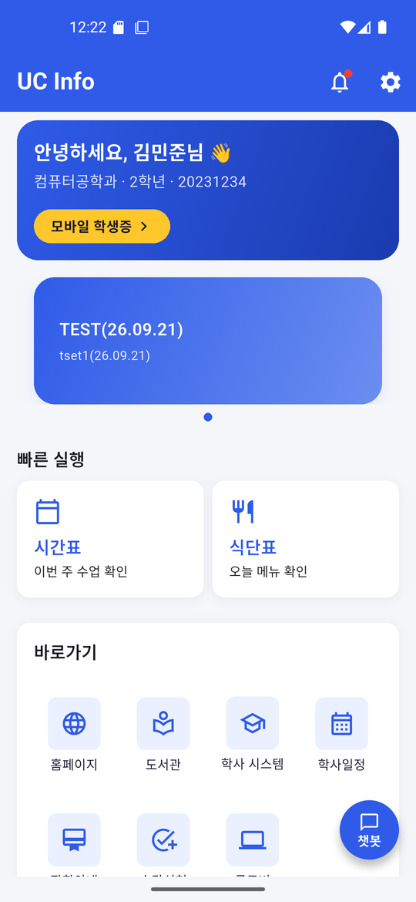
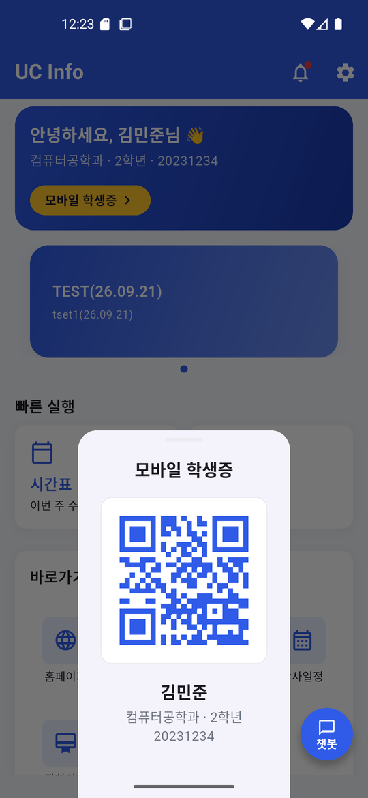
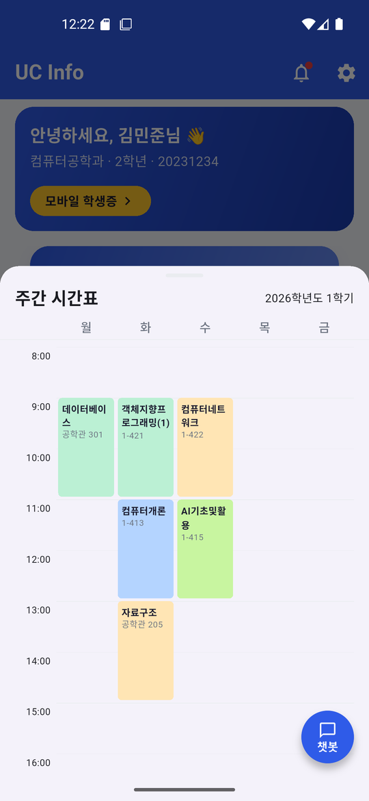
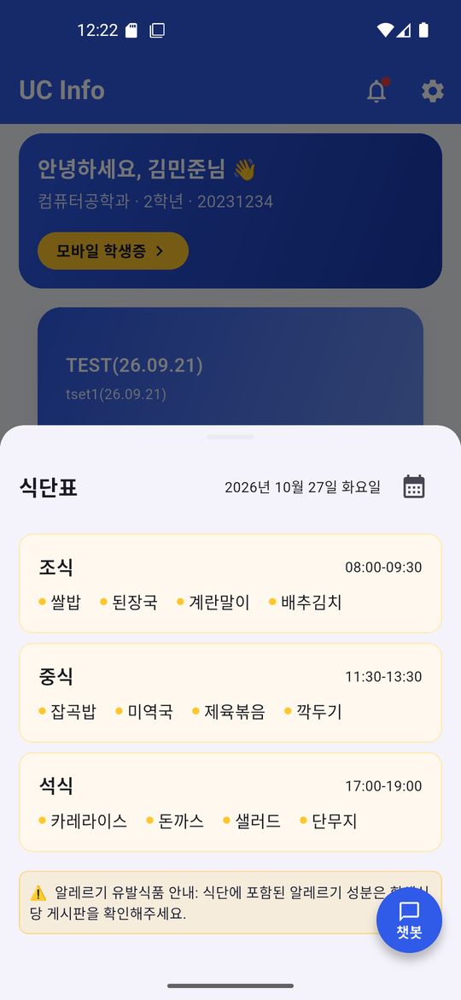
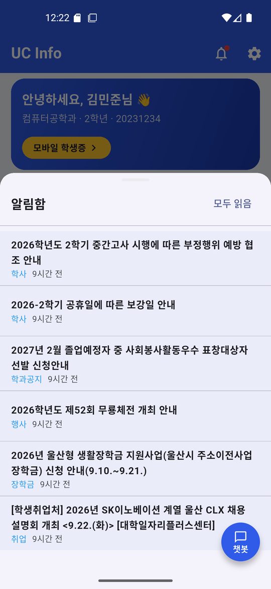
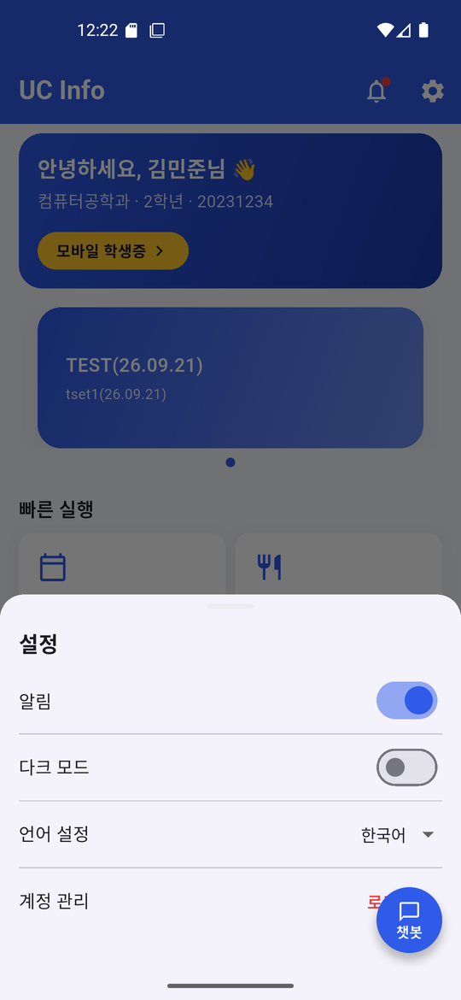
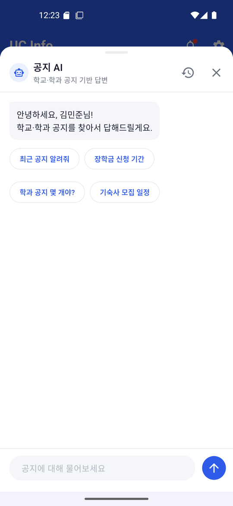
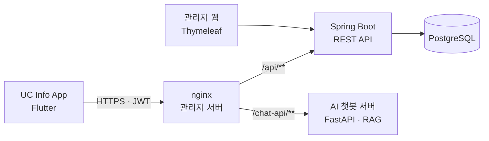

<div align="center">

# UC Info

**울산과학대학교 재학생을 위한 학생 포털 앱**

시간표, 식단, 공지, 장학금, 학사 일정을 한 앱에서 확인하고, 공지 AI 챗봇에게 바로 물어봅니다.




</div>

<br>

## 📁 프로젝트 소개

+ **UC Info**는 대학교 학사 정보를 관리자와 학생 양쪽에서 다루는 팀 프로젝트입니다. 이 저장소는 그중 **학생용 모바일 앱(Flutter)** 을 담당합니다.
+ 학생은 학번 인증 후 시간표·수강신청, 식단, 공지, 장학금, 학사 일정을 조회하고, 공지 AI 챗봇에게 공지 내용을 질문할 수 있습니다.
+ 앱의 데이터는 관리자 웹에서 등록·관리되고, 관리자 서버의 **JWT 인증 REST API**로 내려받습니다.

### 🔗 함께 만든 저장소

| 저장소 | 역할 |
|---|---|
| **Uc_Info** (현재) | 학생용 Flutter 앱 |
| [uc-info-administrator](https://github.com/Hasegos/uc-info-administrator) | 관리자 웹(백오피스) + 모바일 REST API 서버 (Spring Boot) |
| [openstack-ai-notice-chatbot](https://github.com/Hasegos/openstack-ai-notice-chatbot) | 공지 RAG 검색 기반 AI 챗봇 서버 (FastAPI) |

<br>

## 🤝 팀 소개

<table>
    <thead>
        <tr><td colspan="3" align="center"><b>UC Info App</b></td></tr>
    </thead>
    <tr align="center">
        <td>박영수</td>
        <td>박형열</td>
        <td>손수호</td>
    </tr>
    <tr align="center">
        <td>
            <a href="https://github.com/xuxtaku7610-del">
                
            </a>
        </td>
        <td>
            <a href="https://github.com/qkrgudduf7273-beep">
                
            </a>
        </td>
        <td>
            <a href="https://github.com/Hasegos">
                
            </a>
        </td>
    </tr>
    <tr>
        <td>기획 · 초기 UI 설계<br>공통 위젯 · 학점 시뮬레이터</td>
        <td>REST API 연동 · 인증/보안<br>공지 · 알림함 · 수강신청</td>
        <td>Play 배포 준비 · 서버 연동<br>공지 AI 챗봇</td>
    </tr>
</table>

<br>

## 🖼️ 화면 구성

### 홈 · 모바일 학생증

<table>
  <tr>
    <td width="50%" align="center"></td>
    <td width="50%" align="center"></td>
  </tr>
  <tr>
    <td align="center">개인화 인사말 · 배너 · 빠른 실행 · 바로가기</td>
    <td align="center">QR 모바일 학생증</td>
  </tr>
</table>

- 메인 담당자 : 박영수
- 주요 개발 기능 : 홈 대시보드 레이아웃, 배너 슬라이드, 바로가기 메뉴, QR 학생증, Pull-to-Refresh

---

### 시간표 · 식단표

<table>
  <tr>
    <td width="50%" align="center"></td>
    <td width="50%" align="center"></td>
  </tr>
  <tr>
    <td align="center">수강 과목을 색상 블록으로 표시</td>
    <td align="center">조식 · 중식 · 석식, 날짜 선택</td>
  </tr>
</table>

- 메인 담당자 : 박형열
- 주요 개발 기능 : 수강신청 연동 주간 시간표, 과목 색상 자동 배정, 식단 달력 날짜 선택 및 날짜별 조회

---

### 알림함 · 설정

<table>
  <tr>
    <td width="50%" align="center"></td>
    <td width="50%" align="center"></td>
  </tr>
  <tr>
    <td align="center">공지 카테고리별 알림 · 모두 읽음</td>
    <td align="center">알림 · 다크 모드 · 언어 · 계정 관리</td>
  </tr>
</table>

- 메인 담당자 : 박형열
- 주요 개발 기능 : 로컬 알림함, 앱 생명주기 연동 새 공지 확인, 계정별 읽음 상태 분리 저장, 다크 모드 동적 색상, 설정 영속화

---

### 공지 AI 챗봇

<table>
  <tr>
    <td width="50%" align="center"></td>
    <td width="50%">
      로그인 후 모든 화면 우측 하단의 <b>챗봇</b> 버튼을 누르면 바텀시트에서 대화합니다.<br><br>
      · 예시 질문 칩으로 바로 질문<br>
      · 답변을 토큰 단위로 스트리밍 표시<br>
      · 답변 근거가 된 공지를 출처 카드로 표시 (원문 링크)<br>
      · 이전 대화 목록 조회 · 이어서 대화 · 삭제
    </td>
  </tr>
</table>

- 메인 담당자 : 손수호
- 주요 개발 기능 : 전역 플로팅 버튼 오버레이, SSE 스트리밍 응답 파싱, 대화 세션 관리, 앱 로그인 토큰(JWT)으로 챗봇 서버 인증

<br>

## ✨ 주요 기능

- **학번 인증** — 이름 · 학과 · 학번으로 본인 확인 후 JWT 발급, 토큰은 보안 저장소(`flutter_secure_storage`)에 저장
- **시간표 · 수강신청** — 개설과목 조회, 수강 신청/취소, 주간 시간표 자동 반영
- **식단표** — 조식 · 중식 · 석식 메뉴와 운영 시간, 달력으로 날짜 선택
- **공지사항** — 학교 · 학과 · 장학 · 취업 공지 탭별 조회, HTML 본문 렌더링, 읽음 처리
- **알림함** — 새 공지 알림, 모두 읽음, 계정별 데이터 분리
- **장학금 · 학사 일정** — 교내/교외 장학금 목록 · 상세, 학사 캘린더
- **학점 시뮬레이터** — 목표 학점을 위한 기말고사 점수 역산
- **공지 AI 챗봇** — 공지 기반 RAG 답변, 스트리밍 응답, 출처 카드
- **안정성** — 전역 에러 처리, 401 시 자동 로그아웃, 네비게이션 중복 방지, Empty State 처리

<br>

## 🛠️ 기술 스택

| 구분 | 사용 기술 |
|---|---|
| Framework | Flutter (Dart SDK ^3.11.0) |
| 상태 관리 | flutter_riverpod ^2.6.1 (StateNotifier / AsyncNotifier, 코드 생성 없음) |
| 라우팅 | go_router ^14.6.0 |
| 네트워킹 | dio ^5.4.0 (REST API, SSE 스트리밍) |
| 보안 저장소 | flutter_secure_storage ^11.1.1 |
| 기타 | intl, qr_flutter, url_launcher, shared_preferences, flutter_widget_from_html_core |

<br>

## 🏗️ 아키텍처



+ 앱은 관리자 서버 하나만 바라보고, nginx가 일반 API와 챗봇 API를 나눠 전달합니다.
+ 챗봇 서버는 관리자 서버가 발급한 **ES256 JWT를 공개키로 검증**하므로, 앱 로그인 한 번으로 챗봇까지 이용합니다.

### 앱 내부 구조

```text
lib/
├── core/
│   ├── constants/      # 앱 상수
│   ├── network/        # ApiClient(Dio), TokenStorage, 예외 처리
│   ├── router/         # GoRouter 라우트 정의
│   ├── theme/          # 디자인 토큰 (색상, 타이포, 간격)
│   └── utils/          # 공통 유틸
├── data/
│   ├── models/         # 데이터 모델
│   └── repositories/   # Repository 인터페이스 + Dio 구현체
├── features/           # 기능별 모듈
│   ├── auth/  home/  timetable/  enrollment/  meal/
│   ├── notice/  notification/  scholarship/  academic_calendar/
│   ├── grade_simulator/  mypage/  settings/
│   └── chatbot/        # 공지 AI 챗봇
├── shared/             # 공통 위젯 · Provider
├── app.dart            # 앱 루트 위젯
└── main.dart           # 앱 진입점
```

<br>

## 🎨 디자인 토큰

| 용도 | 색상 | 코드 |
|---|---|---|
| Primary (브랜드) | 파란색 | `#2F5BE8` |
| Accent (강조) | 노란색 | `#FFC72C` |
| Background | 연회색 | `#F4F6FA` |
| Error | 빨간색 | `#E84040` |

<br>

## 🚀 시작하기

### 사전 요구사항

- Flutter SDK ([공식 가이드](https://docs.flutter.dev/get-started/install))
- Dart SDK ^3.11.0 이상

### 설치 및 실행

```bash
git clone https://github.com/xuxtaku7610-del/Uc_Info.git
cd Uc_Info
flutter pub get
flutter run
```

### 빌드

```bash
# Android App Bundle (Google Play)
flutter build appbundle --release

# iOS (macOS 필요)
flutter build ios --release
```

<br>

## 📌 개발 현황

- [x] 학번 인증 (보안 저장소, 자동 로그아웃)
- [x] 홈 대시보드 · 배너 · Pull-to-Refresh
- [x] 주간 시간표 · 수강신청
- [x] 식단표 날짜별 조회
- [x] 공지사항 목록 · 상세 (HTML 렌더링)
- [x] 알림함
- [x] 설정 (다크 모드, 알림)
- [x] 학점 시뮬레이터 · 장학금 · 학사 일정
- [x] 공지 AI 챗봇
- [x] Google Play 비공개 테스트 배포 준비
- [ ] 공지사항 한→영 번역
- [ ] 캠퍼스 맵 고도화

<br>

## 📄 라이선스

본 프로젝트는 울산과학대학교 내부 프로젝트로, 외부 배포를 제한합니다.
